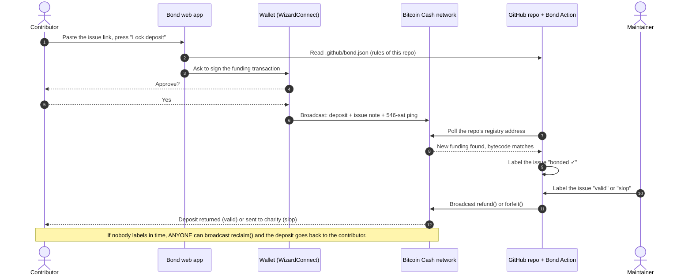

<p align="center">
  <picture>
    <source media="(prefers-color-scheme: dark)" srcset="packages/web/public/brand/bond-logo-dark.svg">
    
  </picture>
</p>

<p align="center"><strong>Spam pays. Humans don't.</strong><br>A small, refundable Bitcoin Cash deposit that stands between a maintainer's inbox and AI slop.</p>

<p align="center">
  <a href="#the-idea">The idea</a> ·
  <a href="#how-it-works-at-a-glance">How it works</a> ·
  <a href="#using-bond">Using Bond</a> ·
  <a href="#install-it-on-your-repo-maintainers">Install</a> ·
  <a href="#the-contract">The contract</a> ·
  <a href="#limitations-honest-list">Limitations</a>
</p>

> **BCH BLAZE 2026 · Mainnet Track · a new project, built 20–22 Nov 2026.**
>
> - Presentation: _TODO: deck link (anyone with the link)_
> - Source code: [github.com/SamuelDharshi/Bond](https://github.com/SamuelDharshi/Bond)
> - Live site: [bond.luffyy.tech](https://bond.luffyy.tech) · Video: _TODO_
> - Vote with EMBER2026: _TODO: token-aware `bitcoincash:z…` address_

---

## Contents

1. [The idea](#the-idea)
2. [How it works at a glance](#how-it-works-at-a-glance) (sequence diagram and flow charts)
3. [Using Bond](#using-bond): step-by-step for contributors, maintainers and anyone else
4. [What happens inside a deposit](#what-happens-inside-a-deposit) (the transaction and the states)
5. [The contract](#the-contract)
6. [The web app](#the-web-app) (pages and screen flow)
7. [The GitHub Action](#the-github-action)
8. [Install it on your repo (maintainers)](#install-it-on-your-repo-maintainers)
9. [Develop and test](#develop-and-test)
10. [How Bond meets the BLAZE requirements](#how-bond-meets-the-blaze-requirements)
11. [Limitations (honest list)](#limitations-honest-list)

---

## The idea

Open-source maintainers are drowning. Large language models make it free to write a plausible-looking bug report, pull request or security finding, and reading each one still costs a human real time. In January 2026 curl ended its bug bounty because AI-generated slop reports cost more to triage than they were worth.

The usual defences all have a catch:

| Approach                    | Problem                                                          |
| --------------------------- | ---------------------------------------------------------------- |
| "Please read the docs"      | Slop generators ignore it.                                       |
| Account-age rules, CAPTCHAs | Cheap to automate, and they punish genuine newcomers.            |
| Charging a fee              | Genuine reporters pay too, and the maintainer is paid to ignore. |
| Banning/reporting           | Reactive: the time was already spent.                            |

**Bond makes the sender put up a small deposit that comes back if they were genuine.**

- A genuine contributor locks a small amount of Bitcoin Cash against one specific issue, and gets it **all back** (minus a tiny network fee) once the maintainer says the report is valid, or after a timeout if nobody looks at it.
- A spammer who sends hundreds of reports has to lock up money for every one, and loses it to **charity** each time a maintainer marks it as slop.
- The maintainer never receives the money, so there is no incentive to mark real reports as spam, and no wallet to look after.

Bond raises the **cost of slop** without charging honest people. It makes spam expensive instead of trying to detect it (see [Limitations](#limitations-honest-list)).

### Three outcomes, nothing else

```
                             ┌──────────────────────────────────────┐
                             │   Deposit locked on Bitcoin Cash,    │
                             │   bound to ONE GitHub issue          │
                             └──────────────────┬───────────────────┘
                                                │
              ┌─────────────────────────────────┼─────────────────────────────────┐
              ▼                                 ▼                                 ▼
   maintainer labels "valid"        maintainer labels "slop"           nobody acts in time
              │                                 │                                 │
              ▼                                 ▼                                 ▼
   ┌─────────────────────┐          ┌─────────────────────┐          ┌─────────────────────┐
   │ REFUND              │          │ FORFEIT             │          │ RECLAIM             │
   │ back to contributor │          │ to the CHARITY      │          │ back to contributor │
   │ (needs the bot key) │          │ (needs the bot key) │          │ (needs NO key)      │
   └─────────────────────┘          └─────────────────────┘          └─────────────────────┘
```

The rules are enforced by a **CashScript covenant** on-chain, not by trust in a server: whatever the bot's key does, money can only go to the contributor or to the charity.

---

## How it works at a glance

### Sequence diagram



### The whole system in one picture

```
   CONTRIBUTOR                                                         MAINTAINER
 ┌─────────────┐        ┌───────────────┐                          ┌───────────────┐
 │  Browser    │        │ GitHub repo   │                          │ GitHub issue  │
 │  Bond site  │        │ .github/      │◄── reads rules ──┐       │ labels:       │
 └──────┬──────┘        │   bond.json   │                  │       │  valid / slop │
        │               └───────┬───────┘                  │       └───────┬───────┘
        │ 1. paste issue link   │                          │               │ 4. label
        │                       │ 2. rules                 │               ▼
        ▼                       ▼                          │       ┌───────────────┐
 ┌─────────────┐ 3. fund  ┌───────────────┐   polls    ┌───┴───────────────────────┐
 │ Wallet      │─────────►│ Bitcoin Cash  │◄───────────│ GitHub Action (the bot)   │
 │ WizardConnect│ deposit │ blockchain    │            │  holds a refund/forfeit-  │
 └─────────────┘  + note  │               │───────────►│  only key, nothing more   │
                          │  ┌─────────┐  │ 5. refund  └───────────────────────────┘
                          │  │  BOND   │  │    or forfeit
                          │  │covenant │  │
                          │  └─────────┘  │            ┌───────────────────────────┐
                          └───────┬───────┘            │ Anyone (no wallet, no key)│
                                  │  6. after timeout  │  presses "Return deposit" │
                                  └───────────────────►│  on the Status page       │
                                                       └───────────────────────────┘
```

**No backend, no indexer, no database.** The web app and the Action read the chain directly from public Electrum (Fulcrum) servers.

### A bond's life

```
   (nothing)
       │  contributor locks a deposit
       ▼
  ┌──────────┐   maintainer: "valid"    ┌───────────┐
  │          │─────────────────────────►│ REFUNDED  │  deposit back to contributor
  │  BONDED  │                          └───────────┘
  │          │   maintainer: "slop"     ┌───────────┐
  │          │─────────────────────────►│ FORFEITED │  deposit to the charity
  └────┬─────┘                          └───────────┘
       │ timeout passes (e.g. 14 days)
       ▼
  ┌─────────────┐   anyone, no key        ┌───────────┐
  │ RECLAIMABLE │────────────────────────►│ RECLAIMED │  deposit back to contributor
  └─────────────┘                         └───────────┘
```

A maintainer can still refund or forfeit a bond that is already reclaimable, as long as nobody has reclaimed it yet.

---

## Using Bond

### As a contributor (you want to open an issue or PR)

```
  ┌───────────────┐   ┌───────────────┐   ┌───────────────┐   ┌───────────────┐
  │ 1. Paste the  │──►│ 2. Connect    │──►│ 3. Lock the   │──►│ 4. Done: see  │
  │ issue link    │   │ your wallet   │   │ deposit       │   │ it in my_bonds│
  └───────────────┘   └───────────────┘   └───────────────┘   └───────────────┘
```

1. Open the site and press **bond_an_issue** (or open `/bond`).
2. **Paste the GitHub issue link**, for example `https://github.com/owner/repo/issues/42`. Bond reads the repo's `bond.json` to learn the deposit size and timeout, and tells you what you would lock.
3. **Connect a WizardConnect wallet**. A QR code and a `wiz://` link appear. In the wallet (for example Cashonize, which has a Connect tab), scan the code or paste the link, and approve the connection. The wallet must be on the **same network as the site** (the footer shows `on chipnet` or `on mainnet`).
4. Press **Lock deposit** and **approve the transaction in your wallet**. You are shown a step-by-step progress animation and then a real transaction id that links to a block explorer.
5. Within a few minutes the repo's bot labels the issue **`bonded ✓`**. Now post your issue or PR.
6. Open **my_bonds** at any time to see everything you locked from this browser, its live status, amounts and transaction links.

What you get back: the **whole deposit minus a network fee of at most `maxFeeSats`** (1,500 sats by default, a fraction of a cent).

If the maintainer never responds, open **Status**, find your bond, and when it says **reclaimable** press **Return deposit to contributor**. This needs **no wallet and no key**.

### As a maintainer (you want less slop)

```
  ┌────────────────┐   ┌────────────────┐   ┌────────────────┐   ┌────────────────┐
  │ 1. Add bond.json│─►│ 2. Add the     │─►│ 3. Add a bot   │─►│ 4. Triage with │
  │ + workflow     │   │ GitHub Action  │   │ key as secret  │   │ labels         │
  └────────────────┘   └────────────────┘   └────────────────┘   └────────────────┘
```

Install it once, see [Install it on your repo](#install-it-on-your-repo-maintainers). After that your whole job is two labels:

| You add the label | Result                 | Who gets the money                   |
| ----------------- | ---------------------- | ------------------------------------ |
| `valid`           | The bond is refunded.  | the contributor                      |
| `slop`            | The bond is forfeited. | the charity you chose in `bond.json` |

You never hold a wallet, never receive funds, and never need to fund the bot's key. If you do nothing, the contributor can reclaim after the timeout.

> **Want forfeits to reach you?** The contract does not allow the maintainer key to receive money (that is the point). If you want forfeits to land in your own wallet, set your own address as the repo's `charityAddress` in `bond.json`.

### As anyone else (judge, curious visitor, third party)

- **Look at any issue's bonds**: open **Status**, paste an issue link and read the live chain state: amounts, who funded it, the transactions, whether it is refunded, forfeited or reclaimable.
- **Return a stuck deposit**: any reclaimable bond can be sent back to its contributor by anyone, with one click.
- **Judges**: the **Judges** page is a 90-second guide through the whole flow, also in [`docs/JUDGE.md`](docs/JUDGE.md).
- **Try it safely**: use the **Practice on testnet** switch in the footer to run everything on chipnet with free test coins.

---

## What happens inside a deposit

### The funding transaction

One Bitcoin Cash transaction does four things at once:

```
 Contributor's wallet coins
            │
            ▼
 ┌──────────────────────────── funding transaction ─────────────────────────────┐
 │                                                                              │
 │  out 0  ► the DEPOSIT, locked in the Bond covenant (a unique address per      │
 │           repo rules + issue + contributor)                                   │
 │                                                                              │
 │  out 1  ► OP_RETURN note:  "BOND" | version 1 | issue fingerprint | pkh       │
 │           (a pointer only: it says "this deposit belongs to this issue")      │
 │                                                                              │
 │  out 2  ► 546 sats to the repo's REGISTRY address                             │
 │           (a tiny ping so the bot can find new deposits with plain Electrum)   │
 │                                                                              │
 │  out 3  ► change back to the contributor                                      │
 │                                                                              │
 └──────────────────────────────────────────────────────────────────────────────┘
```

- **Issue fingerprint** = `sha256("github:owner/repo#number")`, lower-cased. The same formula works for issues and PRs.
- **The note is only a pointer.** The bot never trusts it. It rebuilds the contract from the repo's own `bond.json`, derives the address, and only accepts the deposit if the output **matches that exact bytecode**. A forged note finds nothing.

### How a settlement looks on-chain

```
   Refund / Forfeit                         Reclaim (after timeout)
 ┌────────────────────┐                   ┌────────────────────┐
 │ input: the deposit │                   │ input: the deposit │
 │ signed by bot key  │                   │ NO signature       │
 └─────────┬──────────┘                   │ waits N blocks     │
           │                              └─────────┬──────────┘
           ▼                                        ▼
 ┌────────────────────┐                   ┌────────────────────┐
 │ output: contributor│  (refund)         │ output: contributor│
 │   or the charity   │  (forfeit)        └────────────────────┘
 └────────────────────┘
   Anything else is rejected by the network.
```

Rules enforced by the covenant on every path: the output goes to the **exact** allowed address, and **at most `maxFee` sats** can be taken as the network fee.

### Timeouts

```
 Locked ──────────────────────────────────────────────► time
   │◄────────────── reclaimBlocks ───────────────►│
   │   maintainer can refund / forfeit            │   + ANYONE can reclaim
   │   at any moment                              │     (to the contributor)
```

`reclaimBlocks` is set per repo in `bond.json`: about **14 days (2016 blocks)** by default for real repos and a few minutes when testing on chipnet. Chipnet runs faster blocks, so the app converts block counts to minutes and shows "about N more minutes". If you press reclaim too early the app says "not yet" and you retry shortly: the network is the final judge of the timelock.

---

## The contract

[`packages/contracts/Bond.cash`](packages/contracts/Bond.cash), written in CashScript `0.14`, address type P2SH32.

```
contract Bond(contributorPkh, maintainerPkh, charityLock,
              reclaimBlocks, maxFee, subjectHash)

  refund(pubkey, sig)   only the bot key   ──►  output must pay the contributor
  forfeit(pubkey, sig)  only the bot key   ──►  output must pay the charity
  reclaim()             anyone, no key     ──►  output must pay the contributor,
                                                 and only after reclaimBlocks
```

Safety properties:

- **The bot key can't take the money.** It can only pick "contributor" or "charity", never another destination, and never take more than `maxFee`. A stolen key can grief (send genuine bonds to charity) but can't steal.
- **One deposit, one output.** Output `i` must pay the deposit in input `i`, so two bonds can't be squeezed through one output.
- **One address per issue.** Every parameter changes the bytecode, so each (repo rules, issue, contributor) combination has its own address.
- **Reclaim needs no signature**, so a wallet never has to sign a covenant input.

Full specification, byte layouts and the discovery protocol: [`docs/PROTOCOL.md`](docs/PROTOCOL.md).

---

## The web app

A static single-page app (React, Vite, TypeScript). It runs entirely in the browser.

### Pages

| Page (route)        | What it is for                                                                |
| ------------------- | ----------------------------------------------------------------------------- |
| Home `/`            | The idea, a live block-height strip, how it works, the contract, what is live |
| Bond `/bond`        | The three-step flow: choose issue → connect wallet → lock deposit             |
| My bonds `/mybonds` | Every deposit you locked from this browser, with live status                  |
| Status `/status`    | Live bonds of any issue, and the keyless **Return deposit** button            |
| How `/how`          | Tabbed explanation and the highlighted contract source                        |
| Judges `/judges`    | A 90-second guide for evaluators                                              |

### Screen flow

```
                         ┌─────────────┐
                         │   Home  /   │
                         └──┬───────┬──┘
              bond_an_issue │       │ my_bonds / judges / how_it_works
                            ▼       ▼
  ┌─────────────────────────────┐  ┌────────────┐  ┌───────────┐
  │ Bond  /bond                 │  │ My bonds   │  │ Judges    │
  │  [1 Issue] ► [2 Wallet] ►   │  │ /mybonds   │  │ How       │
  │  [3 Lock deposit]           │  └─────┬──────┘  └───────────┘
  └──────────────┬──────────────┘        │
                 │ after locking         │ "Full status"
                 ▼                       ▼
         ┌─────────────────────────────────────┐
         │ Status  /status                     │
         │  live bonds, Return deposit button  │
         └─────────────────────────────────────┘
```

### What a visitor sees during a transaction

```
  signing in wallet ──► broadcast ──► in mempool ──► 1 confirmation ──► settled
        ●─────────────────●──────────────●───────────────●───────────────●
   (every step has a live animation and links to the block explorer)
```

### Networks

`BCH_NETWORK` is the single switch for the whole project. Production builds open on **mainnet**; the footer has a **Practice on testnet** switch (chipnet, free test coins). Everything network-specific (address prefixes, servers, explorers, block timing) lives in one file, [`packages/core/src/network.ts`](packages/core/src/network.ts), and a check script proves no network string exists anywhere else.

---

## The GitHub Action

[`packages/action`](packages/action) is bundled into one file and committed, so a repo can use it directly.

```
   every 5 minutes  ┐
   issue labeled    ├──►  Action runs
   manual run       ┘          │
                              ▼
        ┌───────────────────────────────────────────────┐
        │ 1. read .github/bond.json                     │
        │ 2. look at the registry address on-chain      │
        │ 3. for each new deposit: label the issue      │
        │    "bonded ✓" if the bytecode matches         │
        │ 4. issue labeled "valid" → refund()           │
        │    issue labeled "slop"  → forfeit()          │
        │ 5. past the timeout → reclaim() on its own    │
        └───────────────────────────────────────────────┘
```

It holds only the refund/forfeit-only key (secret `BOND_MAINTAINER_WIF`). The key never needs funds: fees come out of the deposit, capped by `maxFeeSats`.

---

## Install it on your repo (maintainers)

1. **Make a key** (the bot's refund/forfeit-only key): `pnpm wallets:new`, then copy `MAINTAINER_WIF` and its `pkh`.
2. **Add `.github/bond.json`** (this repo's own [.github/bond.json](.github/bond.json) is a working example):

   ```json
   {
     "version": 1,
     "network": "mainnet",
     "maintainerPkh": "<pkh hex>",
     "charityAddress": "bitcoincash:q…",
     "minValueSats": 50000,
     "reclaimBlocks": 2016,
     "maxFeeSats": 1500
   }
   ```

   | Field            | Meaning                                                               |
   | ---------------- | --------------------------------------------------------------------- |
   | `maintainerPkh`  | hash of the bot key, the only key allowed to refund or forfeit        |
   | `charityAddress` | where forfeited deposits go                                           |
   | `minValueSats`   | the smallest deposit a contributor must lock                          |
   | `reclaimBlocks`  | how long before anyone can send a stuck deposit back (2016 ≈ 14 days) |
   | `maxFeeSats`     | the most the network fee can take from a deposit (300 to 2000)        |

3. **Add the workflow**: copy [.github/workflows/bond.yml](.github/workflows/bond.yml) and point `uses:` at this repo's `packages/action`.
4. **Add the secret** `BOND_MAINTAINER_WIF` (Settings → Secrets → Actions) and create the labels `bonded ✓`, `valid` and `slop`.
5. Tell contributors to bond their issue at your Bond site, or link it in your `CONTRIBUTING.md`.

---

## Develop and test

```bash
pnpm install
pnpm wallets:new           # 3 chipnet wallets → .env (never overwrites)
pnpm faucet                # chipnet coins for the contributor (captcha: you type the sum)
pnpm balance               # real balances from Electrum
pnpm build                 # compile contract, typecheck all, bundle Action, build web
pnpm test:unit             # pure functions only (codec, subjectHash, config)
pnpm e2e                   # REAL chipnet: 5 positive + 7 negative cases (needs ~400k sats)
pnpm --filter @bond/web dev
pnpm check:network         # proves no network strings exist outside packages/core/src/network.ts
```

There are **no mocks**: the end-to-end tests fund, refund, forfeit and reclaim real bonds on chipnet and also try (and fail) to break the rules: wrong key, wrong destination, fee over the cap, shared outputs, early reclaim.

### Repository map

```
Bond.cash ─► packages/contracts   the covenant, SDK, discovery
             packages/core        network config, codecs, Electrum client, timelock maths
             packages/action      the GitHub Action (bundled into dist/)
             packages/web         the website
             scripts/             wallets, faucet, balances, keyless reclaim, mainnet proof
             tests/               unit tests and real-chain end-to-end tests
             docs/                protocol, mainnet flip, decisions, judge guide, submission
```

### Deploy

`vercel --prod` uses `vercel.json` (it rewrites every path to the single-page app, so URLs are clean like `/bond`). Production builds default to **mainnet**. The mainnet flip is in [docs/MAINNET.md](docs/MAINNET.md).

---

## How Bond meets the BLAZE requirements

| Requirement                      | How                                                                                                                                    | Proof                                                                                                                                                 |
| -------------------------------- | -------------------------------------------------------------------------------------------------------------------------------------- | ----------------------------------------------------------------------------------------------------------------------------------------------------- |
| Real BCH transactions            | Fund, refund, forfeit and keyless reclaim are built, signed and broadcast through real Fulcrum servers. No mocks.                      | [`docs/proof/TXIDS.md`](docs/proof/TXIDS.md) (real mainnet transactions: lock, refund and forfeit, recorded 22 Nov 2026; chipnet runs are listed too) |
| Live site judges can use         | Static site, mainnet by default in production builds, with a "Practice on testnet" switch.                                             | [bond.luffyy.tech](https://bond.luffyy.tech) · judge guide: [`docs/JUDGE.md`](docs/JUDGE.md)                                                          |
| WizardConnect wallet flow        | The contributor connects and signs the funding transaction over WizardConnect (`@wizardconnect/react`, relays configurable).           | [`packages/web/src/lib/wallet.ts`](packages/web/src/lib/wallet.ts)                                                                                    |
| Original work disclosed          | New project built during the hackathon. It uses open-source libraries (CashScript, libauth, WizardConnect, React, three.js) as listed. | `package.json` files                                                                                                                                  |
| Public repo, README, limitations | This file.                                                                                                                             | [Limitations](#limitations-honest-list)                                                                                                               |

---

## Limitations (honest list)

- **Bond puts a price on spam instead of trying to detect it.** A spammer who sends a hundred fake reports loses a hundred deposits to charity, while a genuine contributor loses nothing. Each repo sets the deposit size in `bond.json`, so a maintainer who gets more spam can raise it.
- **Maintainer griefing is possible.** The bot key (or a malicious maintainer) can forfeit a genuine bond to charity. It can never take the money, but the contributor still loses it.
- **GitHub scheduled runs can lag** by minutes to hours, and label events depend on Actions being enabled. The keyless reclaim button in the web app works regardless.
- **Changing `bond.json`** (maintainer key, charity, timeout, fee cap) changes the derived address, so the Action stops finding older bonds. They stay safe and reclaimable by their contributor via `reclaim()` with the old parameters.
- **Bond history is per browser.** The "my bonds" list is stored in your browser. The deposits themselves are on-chain and visible on the Status page.
- **Wallet support:** the funding flow needs a wallet that speaks WizardConnect and signs P2PKH inputs on the active network. It's coded against the official packages but hasn't been tested with every wallet.
- **Discovery cost** grows with the registry address history (one transaction fetch per funding). Fine for a repo; a busy repo should rotate its registry address.
- **Unaudited.** Experimental software; don't use it with amounts you can't lose.

## Community Choice

Token-aware donation address: `bitcoincash:z…` _(placeholder: fill in before submission)_

## License

MIT, see [LICENSE](LICENSE).
